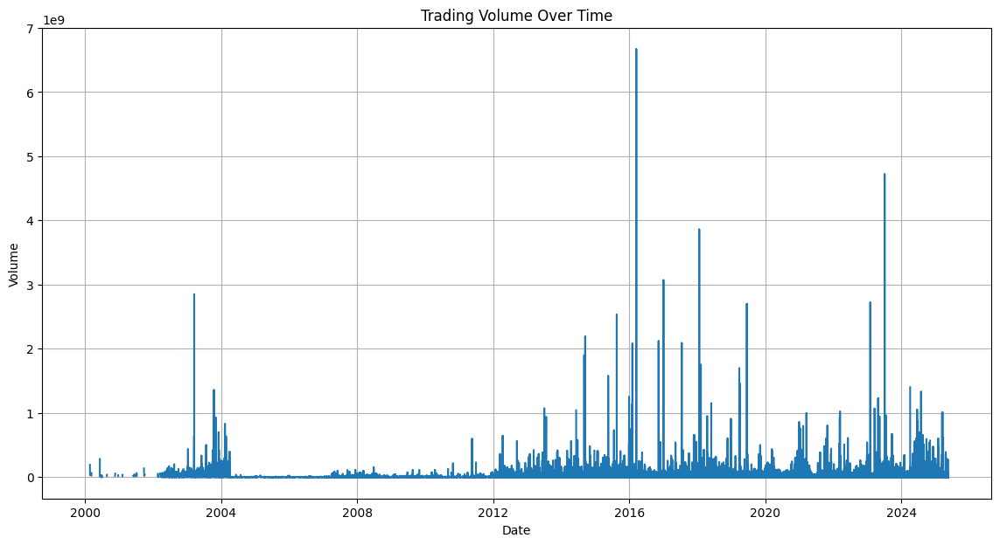
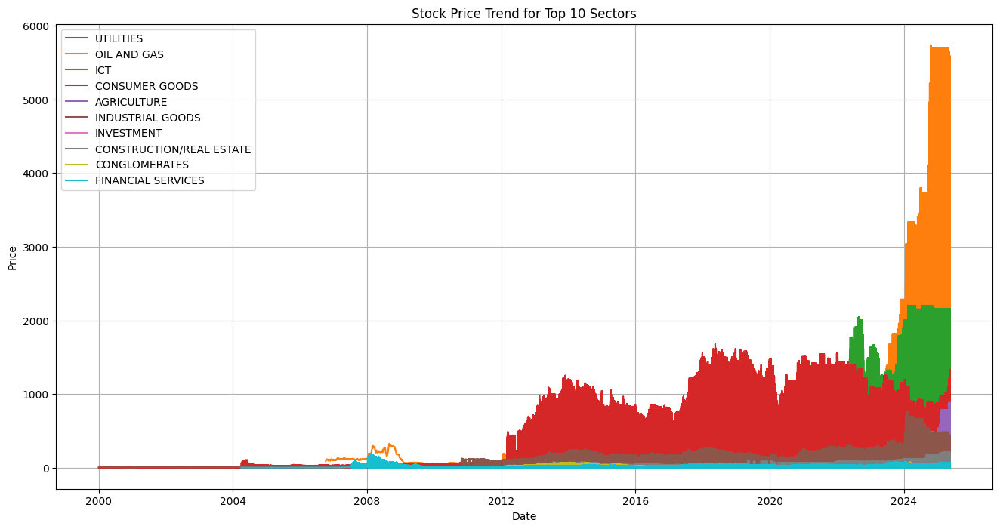
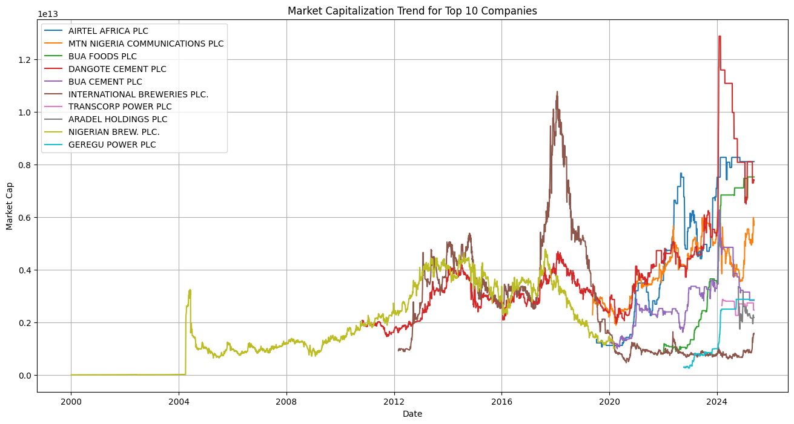
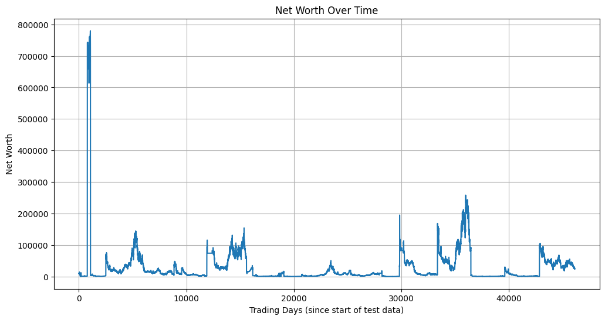
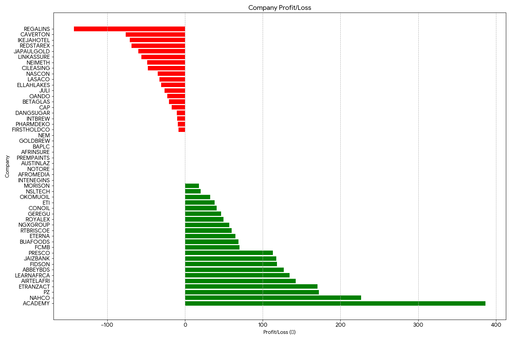

# Deep Reinforcement Learning Trading Agent for the Nigerian Stock Exchange (NGX)

A Proximal Policy Optimization (PPO) agent that learns to Buy, Hold or Sell on Nigerian stock market data, built as my MSc dissertation at the University of Essex.

**Headline result:** on the held-out test period the agent turned ₦10,000 into about ₦24,163 (cumulative return 1.4163), but its Sharpe ratio was only 0.1648. It made money, but with high volatility, and I treat the result as a promising proof of concept rather than a robust strategy.

📄 **[Read the full dissertation (PDF)](report/Dissertation_NGX_PPO_Agent.pdf)**

---

## Problem

Deep reinforcement learning (DRL) has been widely studied on large, liquid markets such as the NYSE, NASDAQ and FOREX, but very little research applies it to African markets. The NGX is volatile, has lower liquidity and is shaped by inflation and policy changes, which makes it a hard and interesting test case.

**Research questions**
1. Can a PPO-based agent learn profitable trading strategies from Nigerian stock price data?
2. What issues and limitations arise when applying DRL to a frontier market like Nigeria?

## Data

- **Source:** Kaggle, *Nigerian Financial Market Data (2000-2025)*
- **Size:** about 307,582 daily records, 145 companies, 13 sectors
- **Fields:** date, price, open, high, low, change %, volume, sector, sub-sector, market classification, shares outstanding, market cap
- The dataset is not stored in this repo. See [`data/README.md`](data/README.md) for how to download it.

### Exploratory analysis

Notebook: [`01_exploratory_analysis.ipynb`](notebooks/01_exploratory_analysis.ipynb)

| | |
|---|---|
|  |  |
| Trading volume over time | Price trend for the top 10 sectors |



*Market capitalisation trend of the 10 largest companies (Airtel Africa, MTN Nigeria, BUA Foods, Dangote Cement and others).*

## Approach

Notebook: [`02_ppo_agent.ipynb`](notebooks/02_ppo_agent.ipynb)

**1. Preprocessing and features**
- Date set as index, missing values forward-filled, warm-up rows dropped
- Technical indicators: SMA-20, SMA-50, RSI-14, MACD and MACD signal line
- Min-max scaling of numeric features to [0, 1]
- Chronological split: 70% train, 15% validation, 15% test

**2. Custom trading environment** (built with Gymnasium)

| Component | Design |
|---|---|
| Observation | Flattened window of the last 14 time steps of all numeric features |
| Actions | 0 = Hold, 1 = Buy (invest full balance), 2 = Sell (sell all shares) |
| Reward | Percentage change in portfolio net worth between steps |
| Starting capital | ₦10,000 |
| Frictions | 0.05% slippage on buys and sells. Transaction cost parameter exists but was set to 0 |
| Termination | End of the dataset |

**3. PPO agent** (Stable-Baselines3, `MlpPolicy`)

| Setting | Value |
|---|---|
| Policy / value network | 2 hidden layers of 64 units each |
| Learning rate | 0.0001 (see note below) |
| Rollout size (`n_steps`) | 2048 |
| Batch size, gamma, GAE lambda, clip range | Stable-Baselines3 defaults (64, 0.99, 0.95, 0.2) |
| Training timesteps | 50,000 |

> **Note:** the dissertation text lists the default learning rate (0.0003). The notebook code uses 0.0001, which is the value that produced the reported run.

**4. Baseline: buy and hold**

Notebook: [`03_buy_and_hold_baseline.ipynb`](notebooks/03_buy_and_hold_baseline.ipynb)

₦10,000 split equally (₦200 each) across 50 randomly selected companies, bought at the start of 2022 and held to the end of the year.

## Results

| Strategy | Starting capital | Final value | Cumulative return | Sharpe ratio |
|---|---|---|---|---|
| **PPO agent** (test set) | ₦10,000 | ≈ ₦24,163 | 1.4163 (141.6%) | 0.1648 |
| Buy and hold (50 stocks, 2022) | ₦10,000 | ₦11,480.07 | 0.1480 (14.8%) | not calculated |



*Net worth of the PPO agent across the test data. It captures profitable stretches, including one sharp spike early on, but also gives back gains and swings widely.*



*Buy-and-hold profit or loss per company (₦200 invested in each). ACADEMY, NAHCO and ETRANZACT gained most; REGALINS, CAVERTON and IKEJAHOTEL lost most.*

**Interpretation:** the agent found profitable patterns in absolute terms, but a Sharpe ratio near zero means the returns came with a lot of risk. As discussed in the dissertation, the result may not replicate across training runs, so I treat it as evidence that PPO can find signal in the NGX rather than as a deployable strategy.

## Limitations

I want to be upfront about the limits of this work:

- **Scaling before splitting.** The `MinMaxScaler` is fitted on the full dataset before the train/validation/test split, which lets information from the test period leak into training.
- **Stocks treated as one series.** Rows for all companies are stacked by date and fed to the agent as a single time series, rather than trading one stock at a time. The test set is therefore about 46,000 steps, and the "trading days" on the net worth chart are rows, not calendar days.
- **Comparison is not like-for-like.** The PPO agent was tested on the last 15% of the data, while buy and hold covers 2022 on 50 random stocks, so the 141.6% vs 14.8% gap is not a fair head-to-head. The buy-and-hold stock selection was random and unseeded, so a rerun will give different numbers.
- **Single run.** Only one training run and one random seed were reported. The agent may have benefited from luck.
- **No transaction costs.** Only slippage was applied in the reported run.
- **Simple action space.** The agent goes all-in on every buy and sell.
- **Validation set unused.** It was created but not used for tuning, and no hyperparameter search was done.

## Future work

- Fit the scaler on training data only, and train and test per stock or on a proper multi-asset portfolio
- Reward shaping with the Sharpe ratio or drawdown penalties
- Realistic transaction costs and risk controls (stop-loss, position sizing)
- Continuous action space (partial position sizes)
- Hyperparameter tuning (for example with Optuna) and multiple seeds
- More indicators (Bollinger Bands, ATR, OBV) and macroeconomic features such as inflation, exchange rate and oil price
- Like-for-like benchmarks over the same period, including a moving-average strategy

## Repository structure

```
ngx-ppo-trading-agent/
├── data/                 # dataset instructions (CSV not included)
├── images/               # figures used in this README
├── notebooks/
│   ├── 01_exploratory_analysis.ipynb
│   ├── 02_ppo_agent.ipynb
│   └── 03_buy_and_hold_baseline.ipynb
├── report/
│   └── Dissertation_NGX_PPO_Agent.pdf
├── requirements.txt
└── README.md
```

## How to run

1. Clone the repository and install the dependencies:
   ```bash
   git clone https://github.com/Omega-Ikechukwu/ngx-ppo-trading-agent.git
   cd ngx-ppo-trading-agent
   pip install -r requirements.txt
   ```
2. Download the dataset from Kaggle (*Nigerian Financial Market Data (2000-2025)*), rename it `NGX_Stocks_2000-2025.csv` and place it in the `data/` folder.
3. Open the notebooks in order using Jupyter or Google Colab and run all cells.

Training results vary between runs, so your numbers will not match the dissertation exactly.

## Tech stack

Python, pandas, NumPy, Matplotlib, Seaborn, scikit-learn, Gymnasium, Stable-Baselines3 (PPO)

## Author

**Omega Stephen Ikechukwu**
MSc, University of Essex (School of Mathematics, Statistics and Actuarial Science)

[LinkedIn](https://www.linkedin.com/in/ikechukwuomega) | [Email](mailto:ikechukwuo48@gmail.com)

*This is my personal MSc dissertation project, not an official University of Essex project.*
